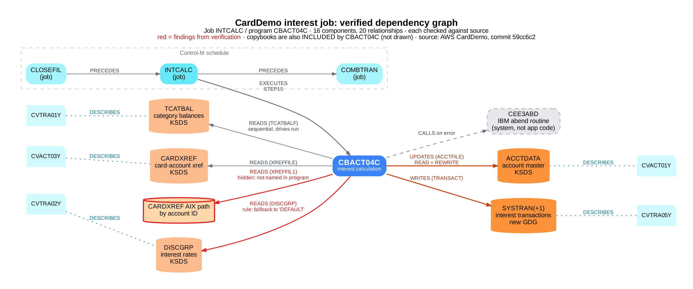

# Step 6: Dependency Graph of the Interest Job (Neo4j)

**Reviewer:** Eduardo Bautista, PhD · **Date:** 2026-10-13
**Question:** can the AI's dependency analysis of the interest job be trusted once every link is checked against the source, and what can a graph of it answer that a list cannot?

## Summary
An AI assistant extracted every dependency of job `INTCALC` and program `CBACT04C` from the CardDemo source: the JCL, the program, its copybooks and the Control-M schedule. I verified each item against the cited file and line, then loaded the verified result into a Neo4j graph database.

- **36 items checked:** 16 components (jobs, programs, datasets, copybooks, one system routine) and 20 relationships.
- **35 correct as extracted, 1 corrected:** the AI cited line 42 of `INTCALC.jcl` for the SYSTRAN dataset. The DSN is on line 41 (the `TRANSACT` DD statement starts at line 37 and continues). No dependency was missing or invented.
- **A hidden dependency, confirmed:** the program never names DD `XREFFIL1`, yet the job needs it. The READ at line 394 uses the alternate key `FD-XREF-ACCT-ID`, which is reached through the alternate-index path that `XREFFIL1` points to. A tool that reads only the program misses this.
- **A business rule, documented:** when an account's disclosure group is not found (file status `'23'`, line 416), the program reads again with the key `'DEFAULT'` (line 444). This is how every account in the Step 3 data ended up on the DEFAULT rate.

## The graph

Diagram drawn with Graphviz by Claude (AI assistant) from the same verified data that was loaded into Neo4j (source: `dependency-graph.dot`). The live Neo4j view is in [screenshots/00-full-graph-cbact04c.png](screenshots/00-full-graph-cbact04c.png).

| Component type | Count | Examples |
|---|---|---|
| Job | 3 | INTCALC, the job before it (CLOSEFIL) and the job after it (COMBTRAN) |
| Program | 1 | CBACT04C |
| SystemRoutine | 1 | CEE3ABD (IBM Language Environment abend service, kept separate from application code) |
| Dataset | 6 | TCATBAL, CARDXREF, CARDXREF alternate-index path, ACCTDATA, DISCGRP, SYSTRAN (new GDG generation) |
| Copybook | 5 | CVTRA01Y, CVACT03Y, CVTRA02Y, CVACT01Y, CVTRA05Y |

Relationship types: `PRECEDES` (scheduler order), `EXECUTES` (job step runs program), `READS`, `UPDATES`, `WRITES` (taken from the OPEN mode and the I/O verbs), `INCLUDES` (COPY statement), `DESCRIBES` (copybook is the record layout of a dataset), `CALLS`.
Every node and relationship carries its source file, line numbers and verification status as properties.

## Questions the graph answers

| # | Question | Result | Screenshot |
|---|---|---|---|
| Q1 | If the account record layout (CVACT01Y) changes, what is affected? | CVACT01Y describes ACCTDATA, which CBACT04C updates, which job INTCALC runs | [q1](screenshots/q1-copybook-impact.png) |
| Q2 | Which files does CBACT04C change? | ACCTDATA (updated, DD ACCTFILE) and SYSTRAN (written, DD TRANSACT): the two files that need before/after reconciliation | [q2](screenshots/q2-files-changed.png) |
| Q3 | In what order do the jobs run? | CLOSEFIL, then INTCALC, then COMBTRAN (Control-M in-conditions) | [q3](screenshots/q3-job-order.png) |
| Q4 | Which business rules were found? | DEFAULT interest-rate fallback on DISCGRP, lines 272, 416, 444 | [q4](screenshots/q4-business-rules.png) |

The queries are in `queries.cypher`.

## Method
1. **AI first pass:** Claude read the CardDemo source and produced a node list and a relationship list, each row citing file and line.
2. **Line-by-line verification:** each row checked against the cited code on GitHub and marked Y / N / ? (`inventory-verified.xlsx`).
3. **Load:** the verified rows were turned into one Cypher script (`load_carddemo_pilot.cypher`) and run on a Neo4j AuraDB Free instance.
4. **Ask:** impact-analysis queries run against the graph (`queries.cypher`).

## Files
| File | What it is |
|---|---|
| `inventory-verified.xlsx` | Workbook with every item, evidence link, verdict and reviewer note |
| `nodes.csv`, `relationships.csv` | The same verified data as plain CSV |
| `load_carddemo_pilot.cypher` | Script that rebuilds the graph in any Neo4j database |
| `queries.cypher` | The four questions above |
| `screenshots/` | Graph and query results from Neo4j |

## Next
Extend the inventory to the other CardDemo batch jobs. A shared copybook or file then links programs across jobs, which is where a graph pays off for impact analysis at scale.
